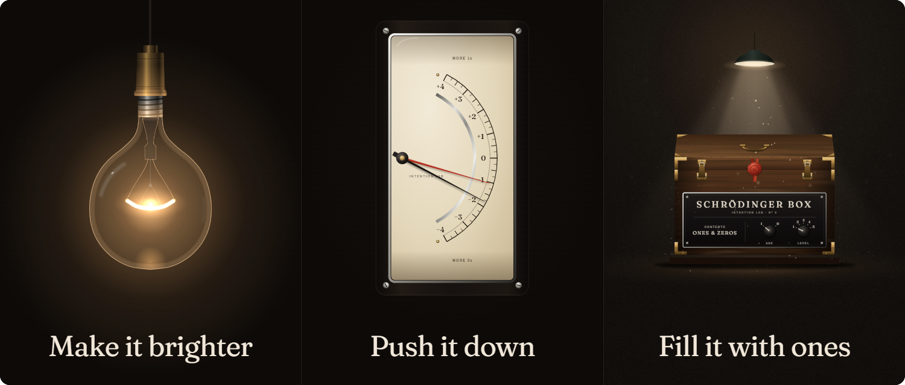
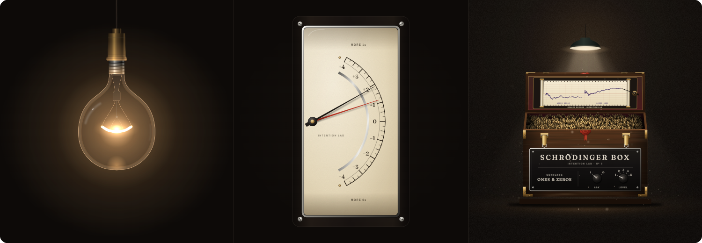
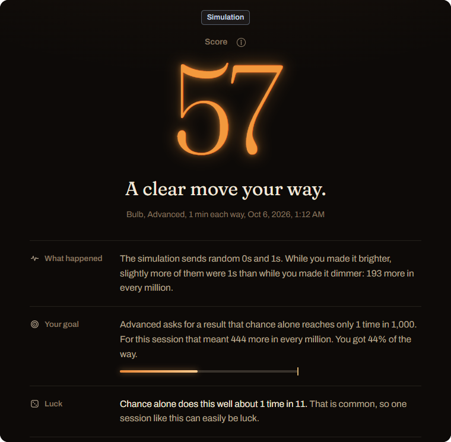
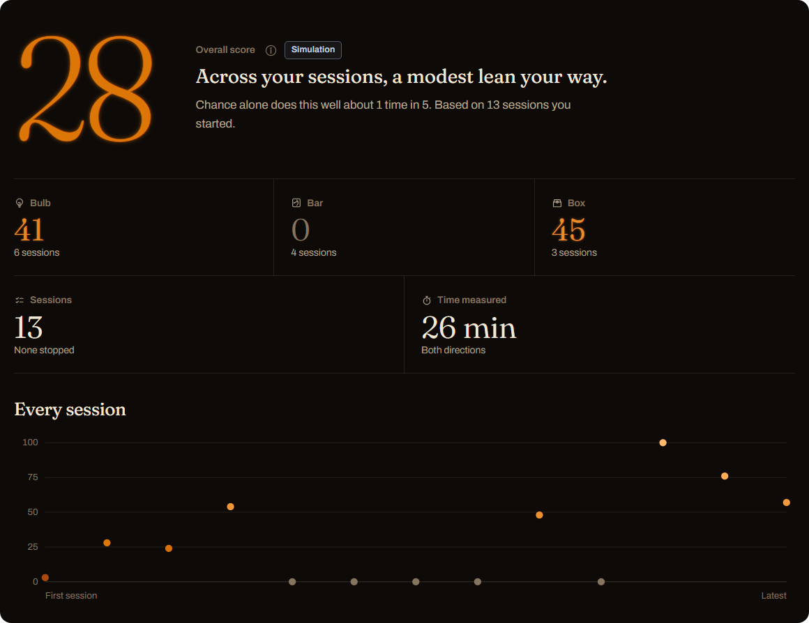
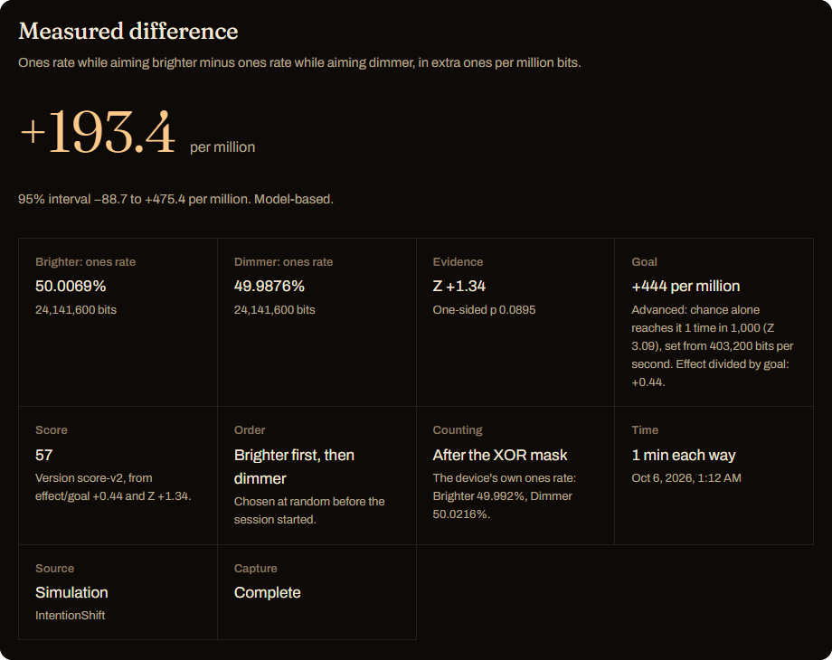
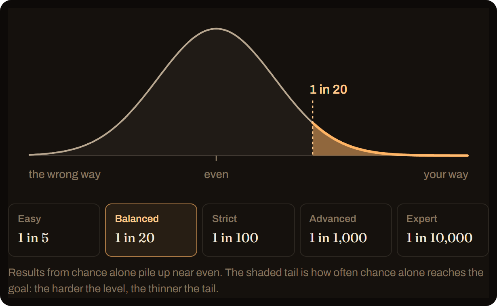

<h1 align="center">Intention Lab</h1>

<p align="center"><strong>Mind over matter, measured.</strong></p>

<p align="center">
A quantum random number generator flips hundreds of thousands of coins a second.<br>
A lamp glows with the 1s and fades with the 0s. A meter climbs and sinks with them.<br>
A sealed box records them unseen and opens only at the end.<br>
Can you lean it your way?
</p>

<p align="center">
  
</p>

Whether attention can tilt a random process is one of the oldest open questions on the edge of science, and these days anyone with a small USB device can ask it. Intention Lab makes it simple and fun for anyone to try: a home testing and training system built around a real quantum device, with instruments beautiful enough to sit with for an hour, a protocol as rigorous as the laboratories that came before, and a record that grows with every session you play. Free, open, and yours alone. Take a seat, set your intention, and see what moves.

## Why this one

People have built tools for this question since the laboratory days: lab-grade generators with their own software, lamps that change colour with the random bits, free experiments online, phone games, and open-source programs that log every trial. Most are now discontinued, online-only, or made for researchers rather than players. Intention Lab picks up the thread: easy and beautiful enough for anyone to play, with the safeguards and the full record of a real experiment underneath:

- **Instruments you can feel**, driven by your own device: a lamp whose hum comes from the physics of a real filament, a needle meter that sings its reading, and a sealed box for playing blind.
- **A protocol that defends itself**: both directions in every session, random order, an XOR mask, and stopped sessions that count against you, so neither a biased device nor a tempted player can fake a result.
- **Plain answers.** Every result says, in everyday words, how often chance alone does as well; levels and scores mean the same on any device, because goals are set in terms of chance; and in the overall score, lucky sessions cannot pile up.
- **A training record**: every session kept, a trend across all of them, comparisons by level, length, time and sound, and challenges: a set number of sessions, chosen in advance and judged together at the end.
- **Private by design.** Windows and Linux, one download, works offline, no account, and nothing leaves your computer.

## What it looks like

The screenshots come from the built-in simulation.

### Three games, three instruments

Three ways to watch the same stream. The **Bulb** shows the last few seconds: more 1s heat the filament, more 0s cool it. The **Bar** shows the whole part so far: a black needle you push past the red one, which marks your goal. The **Box** shows nothing at all: it stays sealed while you play and opens at the end on a record of both parts. With sound on, the lamp hums like a real bulb on a dimmer, the meter sings higher as its needle rises, and the box plays a steady drone that gives nothing away.

<p align="center">
  
</p>

### A score that says what it means

Every finished session gets a score from 0 to 100, with three plain lines underneath: what happened, how far you got toward your level's goal, and how often chance alone does as well.

<p align="center">
  
</p>

### Progress you can't game

Progress combines every session you started into one overall score. It is not an average of your scores: lucky and unlucky sessions cancel out, stopping early never helps, and with no real effect, playing more does not make it climb, while a steady lean keeps adding to it.

<p align="center">
  
</p>

### A challenge, decided in advance

Pick a game, a level, a length and 5, 10 or 20 sessions, and commit to them before the first one. Play them whenever you like; every session you start counts, even one you stop early. After the last session, the challenge gives one verdict on all of them together, by the same rule as the overall score, with nothing left to pick out afterwards.

### Simple and Lab

**Simple** is the game with plain explanations. **Lab** is the same app with the numbers behind it: the measured difference with its interval, ones rates, Z and p, the frozen configuration, a replay, insights across sessions, filters, CSV and JSON export, a simulation source and reference captures. Switching changes what you see, never what is measured.

<p align="center">
  
</p>

## How it works

**A session** has two parts of equal length, 1, 5, 10 or 20 minutes each: brighter and dimmer on the Bulb, up and down on the Bar, ones and zeros on the Box. The order is drawn at random by the computer, never by the device. A five-second countdown comes first and a fifteen-second pause separates the parts.

**What is measured** is the share of 1 bits in each part. Before counting, every bit passes an alternating XOR mask (0101…), the pattern used by the generators of Princeton University's PEAR laboratory (Princeton Engineering Anomalies Research, 1979 to 2007) and of the Global Consciousness Project. A device that leans towards 1s or 0s cannot tilt the result: the mask cancels the lean within each part, and comparing the parts cancels it again. The result is the difference, in extra 1s per million bits.

**Levels** are set by how often chance alone reaches the goal: Easy 1 session in 5, Balanced 1 in 20, Strict 1 in 100, Advanced 1 in 1,000, Expert 1 in 10,000. The goal is worked out from your device's measured speed and the session's length, so each level is equally hard on any device.

<p align="center">
  
</p>

**The score** combines how close you came to the goal with how rare that is by chance. No difference, or a difference the wrong way, scores 0. Reaching the Balanced goal scores about 78 on the Bulb, 69 on the Bar and 73 on the Box, on any device and at any length.

**Every session counts.** We strongly recommend against stopping a session before it ends: it harms your results. It is natural to want to abandon a session that is going badly and keep the ones that go well, and that alone would manufacture an effect out of pure chance. So a session you stop, or that loses its device, is kept and still counts toward the overall score, but only against you. Stopping early can never help, and a session that ends early can never be dropped from the record. This is an intention-to-treat analysis.

**A real effect** would take more than a good session: a plan fixed in advance (a Challenge), a result chance reaches less than 1 time in 1,000, and a replication. The in-app guide explains every step with pictures; in Lab mode it adds the equations.

<details>
<summary>The equations</summary>

For each part, $K$ counted 1s out of $N$ bits, with $p$ the pooled ones rate of both parts:

$$d = \frac{K_\text{Up}}{N_\text{Up}} - \frac{K_\text{Down}}{N_\text{Down}}, \qquad Z = \frac{d}{\sqrt{p(1-p)\left(\frac{1}{N_\text{Up}} + \frac{1}{N_\text{Down}}\right)}}$$

A level whose goal chance alone reaches 1 time in $n$ uses $z_L = \Phi^{-1}(1 - 1/n)$, and its goal for $N$ bits per part is $z_L \sqrt{0.5/N}$. With $r = d / \text{goal}$:

$$S = 100\, M^{w} E^{1-w}, \qquad M = 1 - e^{-2.7r}, \qquad E = 1 - e^{-(Z/1.7)^{2.5}}$$

where $w$ is 0.6 for the Bulb, 0.3 for the Bar and 0.45 for the Box, and $S = 0$ when $d \le 0$. The overall score applies the same formula to all started sessions together ($w = 0.45$, or a game's own $w$ for that game alone), with a sign-flip permutation test for $Z$.

</details>

## What to expect, honestly

**About the levels.** Each level is tuned to a different size of effect, from one that would barely stand out to one that could hardly be missed. That is their design. In practice, they work as encouragement: they give a session a goal and a score, and the easier ones let more of chance look like a win. The effect research actually reports is far smaller than any level. PEAR's benchmark result, about 1 bit in 10,000 following intention, came from 2.5 million trials by 91 people over twelve years, mostly at the laboratory's standard 200 bits a second. Counted per second of effort rather than per bit, an effect that size would be invisible in one of our sessions: with 5-minute parts, it would raise the chance of reaching the Balanced goal from 5% to about 6%. Seen at all, it has to be accumulated: at that rate, with 20-minute parts, reaching 1 in 20 with 80% power takes about three hundred sessions and 1 in 1,000 about eight hundred, and with 5-minute parts four times as many. Our Progress screen exists for exactly this: it combines every session you have started, so a small, steady lean adds up where single scores cannot.

The same literature also reports a minority who did far better: York Dobyns, one of PEAR's researchers, later found its data best explained by a talented minority of about 15% of its operators, and in Helmut Schmidt's experiments, subjects selected for prior success scored at rates that, taken the same way, would reach the Balanced goal in most sessions of five minutes or more here. At PEAR nobody knew in advance who the talented were: its operators were ordinary volunteers, none of whom claimed any special ability. That is the open question Intention Lab puts to you. Most people land near chance; some do not; and the only way to find out which you are is to sit down, aim, and let the record speak. Every session you play adds to it. Where do you stand?

**Longer sessions help a real effect, not luck.** The evidence so far suggests that a real effect does not grow with the number of bits, so the 10 and 20-minute parts give a real lean room to show while leaving chance exactly where it was.

**An invitation to explore.** Can the ability to move a random process with intention be developed? Like any faculty of attention, it may well respond to practice, to focus and to the right state of mind. That is a question you can take up for yourself, and Intention Lab is built to be the instrument. Every session is kept with its level, its length, its sound setting and its time; Progress draws the trend across all of them; and in Lab, Insights lets you compare your first month with your latest, or sessions with the sound on against sessions without; and a Challenge puts a change you believe in to a fair test. Try a different length, a different state of mind, a different game, and watch what the record does. If your ability grows, you will see it grow. Treat it as a practice, keep your sessions honest, and explore.

## Get started

You need:

- Windows 10 or 11 (x64), or Linux (x64).
- A USB hardware random number generator that streams raw random bytes over a serial port. Intention Lab currently supports, and is tested with, the **ubld.it™ TrueRNG V3**; it is recognised and connects with one click. Support for more devices will come in the future. Any other serial device that streams raw random bytes can be chosen and confirmed by hand.
- A current web browser. Intention Lab is tested with Microsoft Edge.

No device yet? Switch to **Lab** and choose the simulation source in the device dialog. Simulated sessions are labelled everywhere and never mix with a device's.

**Windows.** Download `IntentionLab-<version>-win-x64.zip` from the [latest release](../../releases/latest), extract it and double-click `DeviceBridge.exe` in the `IntentionLab` folder. The app opens in your browser at http://127.0.0.1:29871. The program isn't code-signed yet, so Windows may warn about an unrecognised app: choose *More info*, then *Run anyway*.

**Linux.** Download `IntentionLab-<version>-linux-x64.tar.gz`, then:

```sh
tar -xzf IntentionLab-*-linux-x64.tar.gz
cd IntentionLab-linux-x64
./DeviceBridge
```

Your account needs access to serial ports: on Ubuntu, Debian and Fedora run `sudo usermod -aG dialout $USER` once (on Arch Linux the group is `uucp`), then log out and back in.

The program runs in the background while an Intention Lab tab is open and quits by itself about three minutes after the last one closes; **Settings, Quit** stops it at once. Every release lists SHA-256 checksums in `SHA256SUMS.txt`, and its packages carry a build attestation, so `gh attestation verify` can confirm they were built from this repository.

## Your data

Everything stays on your computer. The program listens only on 127.0.0.1, has no accounts and sends nothing anywhere. Sessions are stored in your browser profile (IndexedDB), under the address above.

**Settings, Export backup** saves a complete copy as JSON; **Import backup** restores it, checking every record and never overwriting one you already have. Export a backup before updating: an update that changes the storage format starts with an empty history.

**Profiles** keep players apart. A Default profile is in use from the start; add or rename one in **Settings** when someone else plays. Each profile keeps its own history, scores and choice of level and length for each game, and a backup keeps every session with its profile.

## Build from source

You need the .NET 10 SDK (see `global.json`), the MSVC C++ build tools for the Windows Native AOT build, and Node 24 for the tests. The app itself is plain HTML, CSS and JavaScript, with no build step and no runtime dependencies.

```powershell
# Run from source: a development bridge serving app/ at http://127.0.0.1:29871
powershell -ExecutionPolicy Bypass -File .\scripts\Run.ps1

# Portable packages in dist/
powershell -ExecutionPolicy Bypass -File .\scripts\Publish.ps1                     # Windows x64, Native AOT
powershell -ExecutionPolicy Bypass -File .\scripts\Publish.ps1 -Runtime linux-x64  # Linux x64, single file

# Core, statistics, simulations, score calibration and the bridge's transport checks
npm ci --ignore-scripts
powershell -ExecutionPolicy Bypass -File .\scripts\Test.ps1
```

The browser suites drive headless Microsoft Edge against a separate bridge on port 29872, after a Windows publish, with disposable profiles that never touch your own history:

```powershell
$env:INTENTIONLAB_PORT = '29872'; $env:INTENTIONLAB_IDLE_SECONDS = '0'; $env:INTENTIONLAB_APP_DIR = "$PWD\app"
Start-Process .\dist\IntentionLab\DeviceBridge.exe --no-browser
powershell -ExecutionPolicy Bypass -File .\scripts\Test.ps1 -Browser   # add -Hardware with a device attached
```

`node tests/screenshots.mjs` captures every screen in both modes, at desktop and phone width, into `test-results/ui`. With `--readme`, it makes the pictures in this README instead, into `test-results/readme`.

## Versions and releases

Intention Lab follows [Semantic Versioning](https://semver.org/). The version lives in one place, `Directory.Build.props`, and the app shows it in **Settings**. Changes are listed in [CHANGELOG.md](CHANGELOG.md).

To release, update the version and the changelog, commit, and push a tag such as `v0.2.0`. The [release workflow](.github/workflows/release.yml) checks that the tag matches the version, builds both packages on GitHub's runners, adds checksums and build attestations, and publishes a GitHub release with the changelog's notes. A tag with a suffix, such as `v0.2.0-rc.1`, becomes a pre-release. [CI](.github/workflows/ci.yml) runs the core tests on every push to main and every pull request.

The measurement protocol (`updown-v2`), statistics (`updown-stats-v1`), score (`score-v2`) and interface (`tungsten-ui-v5`) carry versions of their own, recorded with every session, so each result can be traced to the rules it was measured under.

## Project layout

| Path | What it holds |
|---|---|
| `app/` | The whole application: HTML, CSS, fonts, ES modules, workers, storage, import and export |
| `app/js/core/` | The capture engine, protocol, statistics, score, simulation, selection, database and transfer |
| `bridge/` | A small C# program that finds the device, reads its bytes and serves the app on 127.0.0.1 |
| `tests/` | Unit, simulation, calibration, browser and hardware tests, and C# transport checks |
| `scripts/` | Run, publish and test |

## Status

Tested on Windows 11 with a ubld.it TrueRNG V3, and on Linux in WSL (Ubuntu 22.04) with the device passed through. A physical Linux PC is not yet tested, and there is no macOS package.

Intention Lab makes no claim about whether intention can affect a random number generator. It is built so that, if you look, you look carefully.

## License

[MIT](LICENSE). The bundled fonts, Fraunces and Archivo, are under the SIL Open Font License; their licences are in `app/fonts/`.
